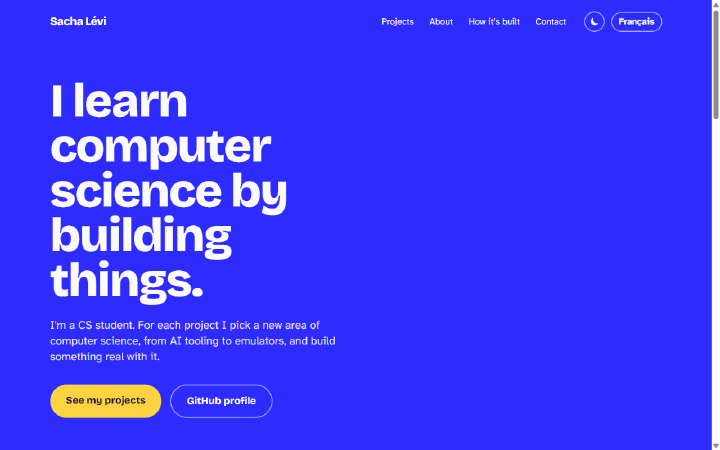
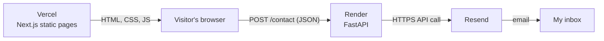

# portfolio

> My bilingual (English/French) portfolio: a static Next.js site with a small FastAPI back end that delivers the contact form to my inbox.

**Live:** https://portfolio-five-khaki-3lwpzpubw8.vercel.app · [How this site is built](https://portfolio-five-khaki-3lwpzpubw8.vercel.app/en/how-its-built)




## Features

- **Browse my projects:** cards with a pitch, proof metrics, tech badges and links, all from one data file.
- **Send me a message:** the contact form is checked, filtered for spam and delivered to my inbox by email; it warns you when the free server is waking up.
- **Read it in English or French:** `/en` and `/fr`, your browser's language on the first visit, and the switch is remembered.
- **Switch to dark mode:** follows your system setting, with a toggle that is remembered and no flash of the wrong theme.
- **Download my CV** in the page's language, and read a "How this site is built" page with the architecture and the problems I solved.

## Architecture



The pages are built in advance and served by Vercel, so they load fast and need no server. Only the contact form needs code on a server: a FastAPI app on Render validates the message, applies the anti-spam rules (honeypot field, 5 messages per network every 10 minutes, a global cap, a lock against parallel requests) and sends it through Resend. Resend is called over HTTPS because Render's free plan blocks outgoing SMTP.

## Run it locally

**Requirements:** Node.js 20.9+ and Python 3.12+.

```bash
git clone https://github.com/E54Sacha/portfolio.git
cd portfolio

# Front end: http://localhost:3000
cd web
npm install
npm run dev
```

In a second terminal, the API (http://localhost:8000):

```bash
cd portfolio/api
python -m venv .venv
.venv/Scripts/activate        # macOS / Linux: source .venv/bin/activate
pip install -r requirements-dev.txt
uvicorn app.main:app --reload
```

The local site still sends the form to the deployed API (`apiUrl` in `web/src/content/site.ts`); point it to `http://localhost:8000` to use your local one. Without email settings, the API answers `503` (not configured). To send real emails, set `RESEND_API_KEY` and `CONTACT_TO`, or `SMTP_USER` and `SMTP_PASSWORD` for your own mailbox (see `api/app/mailer.py`).

**Tests and checks:**

```bash
cd api && pytest          # 29 tests: validation, spam rules, rate limits, CORS, email sending
cd web && npm run lint    # ESLint
cd web && npm run build   # type-checks and builds the static pages
```

## Project structure

```
web/
  src/app/[lang]/              pages for each language: home and how-its-built
  src/components/              Nav, Hero, ProjectTile, About, ContactForm, ThemeToggle…
  src/content/i18n.ts          all interface text, in English and French
  src/content/projects.ts      the project cards (add a project here)
  src/content/site.ts          name, links, API URL, CV files
  src/proxy.ts                 sends "/" to /en or /fr (cookie, then browser language)
  public/                      the CVs (PDF)
api/
  app/main.py                  FastAPI app: POST /contact, GET /health, CORS, rate limiting
  app/mailer.py                sends the email (Resend, or SMTP)
  tests/                       pytest tests
render.yaml                    Render deployment (API)
REQUIREMENTS.md                the scope and day-by-day plan this was built from
```

## What I learned

- **CORS:** the browser, not the server, blocks a page from reading another site's answers; one wrong origin in the settings would have broken the form while it still worked with curl. <!-- TODO: check this is true for you -->
- **Rate limiting is easy to get wrong:** spoofed `X-Forwarded-For` headers, memory that grows forever and parallel requests slipping past the check each needed a fix. <!-- TODO: check this is true for you -->
- **Free hosting shapes the design:** the API sleeps when idle (so the form wakes it early and says so), and outgoing SMTP is blocked (so email goes through an HTTPS API). <!-- TODO: check this is true for you -->
- **Static pages plus a little server code:** every page is static HTML, and only the language redirect and the contact form need a server. <!-- TODO: check this is true for you -->

## What I'd do differently

- Keep the rate-limit counters in a shared store (like Redis): they live in memory, so they reset whenever the free server restarts.
- Use my own domain name with HTTPS instead of the default Vercel address.
- Add a GitHub Actions workflow that runs the tests and the build on every push.
